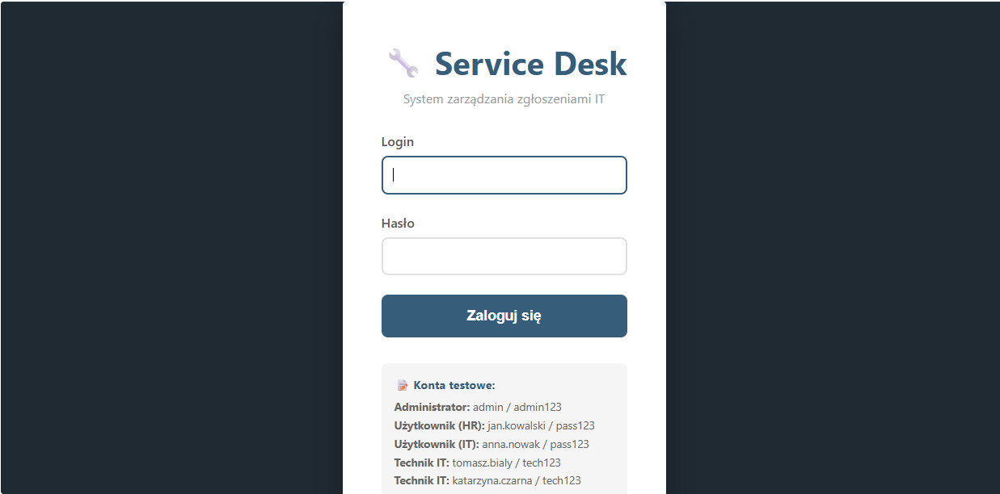
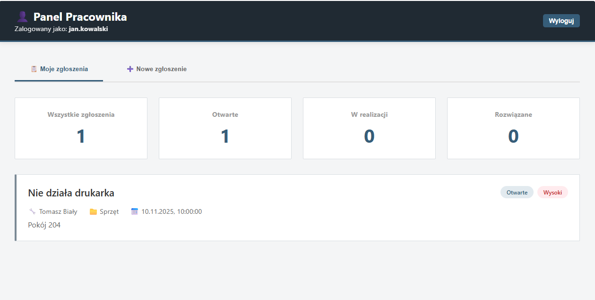
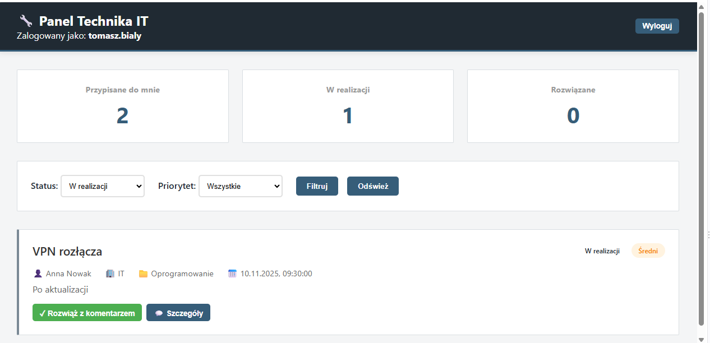
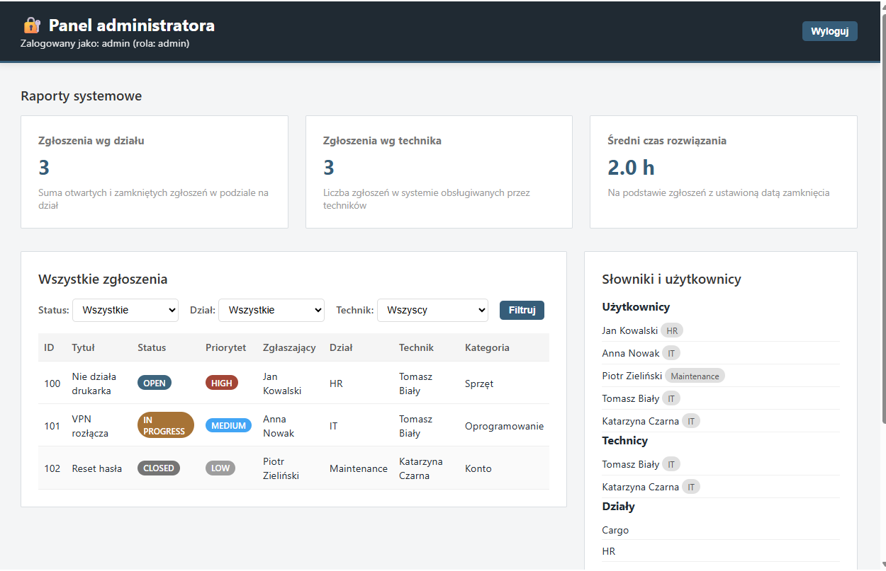

# Service Desk

[English](#service-desk) | [Polski](#service-desk---wersja-polska)

A small web application for handling internal IT support requests. Employees can report issues and follow their progress, technicians can work through assigned tickets, and an administrator can review the queue, reports, and reference data.

The project was built as part of a database applications course and is intentionally kept lightweight: the backend is Spring Boot and the interface uses plain HTML, CSS, and JavaScript.

## Screenshots

| Login | Employee workspace |
| --- | --- |
|  |  |

| Technician workspace | Administrator workspace |
| --- | --- |
|  |  |


## What it does

- Create tickets with a title, description, priority, category, and optional technician assignment.
- Track ticket states: `OPEN`, `IN_PROGRESS`, `RESOLVED`, and `CLOSED`.
- Keep a comment history for every ticket.
- Show employees their own tickets and technicians their assigned work.
- Filter tickets by status, technician, or reporting department.
- Provide ticket-count and average-resolution-time reports.
- Manage users, technicians, departments, and categories through the REST API.

## Tech stack

- Java 21
- Spring Boot 3.3.4
- Spring Data JPA / Hibernate
- H2 in-memory database for the default demo profile
- PostgreSQL profile for a persistent database setup
- Vanilla HTML, CSS, and JavaScript

## Running locally

### Requirements

- JDK 21 or newer
- Maven 3.6 or newer

From the repository root:

```bash
cd api
mvn spring-boot:run
```

Then open [http://localhost:8080/](http://localhost:8080/).

The default profile is `h2`, so the application starts with an in-memory database and sample data. Every restart resets that data.

To use PostgreSQL instead, start the application with the `postgres` profile and provide a local database matching the connection settings in `api/src/main/resources/application.yml`.

## Demo accounts

| Role | Login | Password |
| --- | --- | --- |
| Administrator | `admin` | `admin123` |
| Employee | `jan.kowalski` | `pass123` |
| Employee | `anna.nowak` | `pass123` |
| Employee | `piotr.zielinski` | `pass123` |
| Technician | `tomasz.bialy` | `tech123` |
| Technician | `katarzyna.czarna` | `tech123` |

## H2 console

When running with the default H2 profile, the database console is available at [http://localhost:8080/h2-console](http://localhost:8080/h2-console).

```text
JDBC URL: jdbc:h2:mem:servicedesk
User:     sa
Password: [leave empty]
```

## API overview

| Area | Main endpoints |
| --- | --- |
| Authentication | `POST /api/login` |
| Tickets | `GET, POST /api/tickets`, `GET /api/tickets/my`, `GET /api/tickets/assigned` |
| Ticket workflow | `POST /api/tickets/{id}/assign`, `POST /api/tickets/{id}/status/{status}` |
| Comments | `GET /api/comments/ticket/{ticketId}`, `POST /api/comments` |
| Reports | `GET /api/reports/tickets-count`, `GET /api/reports/avg-resolution-time` |
| Reference data | `/api/users`, `/api/technicians`, `/api/departments`, `/api/categories` |

More endpoint details are available in [API_DOCUMENTATION.md](API_DOCUMENTATION.md).

## Project layout

```text
api/
  src/main/java/com/servicedesk/
    controller/      REST endpoints and server-rendered panels
    service/         Ticket, comment, and authentication logic
    entity/          JPA entities
    repository/      Spring Data repositories
  src/main/resources/
    application.yml  H2 and PostgreSQL profiles
    data.sql         Demo data
web/                 Earlier standalone frontend prototype
```

## Checks

```bash
cd api
mvn test
```

The project also starts cleanly with the H2 profile and can be checked manually using the demo accounts above.

## Notes

This is a course project, not a production-ready help-desk system. Passwords in the demo data are intentionally plain text, and the current role handling is designed for local demonstration. A production version should use Spring Security, password hashing, server-side authorization, and a persistent database.

---

# Service Desk - wersja polska

[English](#service-desk) | [Polski](#service-desk---wersja-polska)

Mała aplikacja webowa do obsługi wewnętrznych zgłoszeń IT. Pracownicy mogą zgłaszać problemy i śledzić ich status, technicy obsługują przypisane zgłoszenia, a administrator przegląda kolejkę, raporty i dane słownikowe.

Projekt powstał w ramach przedmiotu dotyczącego aplikacji bazodanowych. Backend oparto o Spring Boot, a interfejs został wykonany w czystym HTML, CSS i JavaScript.

## Funkcje

- Tworzenie zgłoszeń z tytułem, opisem, priorytetem, kategorią i opcjonalnym przypisaniem technika.
- Obsługa statusów: `OPEN`, `IN_PROGRESS`, `RESOLVED` i `CLOSED`.
- Historia komentarzy dla każdego zgłoszenia.
- Widok własnych zgłoszeń dla pracownika oraz przypisanych zadań dla technika.
- Filtrowanie zgłoszeń po statusie, techniku i dziale zgłaszającego.
- Raporty liczby zgłoszeń oraz średniego czasu rozwiązania.
- Zarządzanie użytkownikami, technikami, działami i kategoriami przez REST API.

## Technologie

- Java 21
- Spring Boot 3.3.4
- Spring Data JPA / Hibernate
- Baza H2 w pamięci dla domyślnego profilu demonstracyjnego
- Profil PostgreSQL dla trwałej bazy danych
- Vanilla HTML, CSS i JavaScript

## Uruchomienie lokalne

### Wymagania

- JDK 21 lub nowsze
- Maven 3.6 lub nowszy

W katalogu głównym repozytorium wykonaj:

```bash
cd api
mvn spring-boot:run
```

Następnie otwórz [http://localhost:8080/](http://localhost:8080/).

Domyślnie aktywny jest profil `h2`, dlatego aplikacja uruchamia się z bazą w pamięci i przykładowymi danymi. Dane są resetowane po każdym ponownym uruchomieniu aplikacji.

Aby użyć PostgreSQL, uruchom aplikację z profilem `postgres` i przygotuj lokalną bazę zgodną z ustawieniami w `api/src/main/resources/application.yml`.

## Konta testowe

| Rola | Login | Hasło |
| --- | --- | --- |
| Administrator | `admin` | `admin123` |
| Pracownik | `jan.kowalski` | `pass123` |
| Pracownik | `anna.nowak` | `pass123` |
| Pracownik | `piotr.zielinski` | `pass123` |
| Technik | `tomasz.bialy` | `tech123` |
| Technik | `katarzyna.czarna` | `tech123` |

## Konsola H2

Przy uruchomieniu z domyślnym profilem H2 konsola bazy jest dostępna pod adresem [http://localhost:8080/h2-console](http://localhost:8080/h2-console).

```text
JDBC URL: jdbc:h2:mem:servicedesk
User:     sa
Password: [pozostaw puste]
```

## Przegląd API

| Obszar | Główne endpointy |
| --- | --- |
| Uwierzytelnianie | `POST /api/login` |
| Zgłoszenia | `GET, POST /api/tickets`, `GET /api/tickets/my`, `GET /api/tickets/assigned` |
| Obsługa zgłoszenia | `POST /api/tickets/{id}/assign`, `POST /api/tickets/{id}/status/{status}` |
| Komentarze | `GET /api/comments/ticket/{ticketId}`, `POST /api/comments` |
| Raporty | `GET /api/reports/tickets-count`, `GET /api/reports/avg-resolution-time` |
| Dane słownikowe | `/api/users`, `/api/technicians`, `/api/departments`, `/api/categories` |

Dokładniejszy opis endpointów znajduje się w [API_DOCUMENTATION.md](API_DOCUMENTATION.md).

## Struktura projektu

```text
api/
  src/main/java/com/servicedesk/
    controller/      Endpointy REST i panele generowane po stronie serwera
    service/         Logika zgłoszeń, komentarzy i logowania
    entity/          Encje JPA
    repository/      Repozytoria Spring Data
  src/main/resources/
    application.yml  Profile H2 i PostgreSQL
    data.sql         Dane demonstracyjne
web/                 Starszy, samodzielny prototyp frontendu
```

## Sprawdzenie projektu

```bash
cd api
mvn test
```

Projekt uruchamia się również poprawnie na profilu H2. Funkcje można ręcznie sprawdzić, korzystając z kont testowych podanych wyżej.

## Uwagi

To projekt uczelniany, a nie gotowy system produkcyjny. Hasła w danych demonstracyjnych są zapisane jawnie, a obsługa ról służy wyłącznie lokalnej prezentacji. W wersji produkcyjnej należałoby zastosować Spring Security, hashowanie haseł, autoryzację po stronie serwera oraz trwałą bazę danych.
